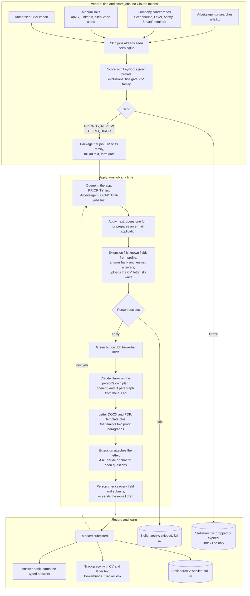

# Job application package for Germany

Tested automatically on Windows, macOS and Linux (Python 3.11 and 3.12), including the Windows and Mac start files.

This package helps one person derive evidence-based CV families, build German ATS CVs and cover-letter templates, filter jobs, fill forms, and archive application records. It never submits an application, accepts consent, solves a CAPTCHA, or enters a password.

You need Windows 10/11 or macOS, Python 3.11 or newer, the Claude desktop app with a Pro or Max plan, and your CVs and supporting documents. Initial discovery normally takes several sittings.

1. Put this folder on your computer.
2. In the Claude desktop app, start a chat and connect this folder.
3. Type: `Read START_HERE.md in the connected folder and follow it.`
4. Answer the questions and add documents when asked.
5. To resume, return to the same chat and type `continue`.

## How it works

### 1. Replication: from this repository to a working setup

Part 1 runs in one Claude chat (Claude does the research and writing; the person answers and approves). Part 2 installs and configures the app on the person's computer. Details: `START_HERE.md` and `guide/`.

```mermaid
flowchart TD
    subgraph GET["Get the package"]
        direction TB
        G1["Download or clone this repository"]
        G2["Claude desktop app: new chat,<br/>connect the folder"]
        G3["Type: Read START_HERE.md<br/>and follow it"]
        G1 --> G2 --> G3
    end

    subgraph CHAT["Part 1, one Claude chat over several sittings: discovery and documents"]
        direction TB
        C0["Capability check: folder, shell, Python tools,<br/>web search, OS; resume from workspace/STATE.md"]
        S1["1 Intake: region, job formats,<br/>career level, languages"]
        S1d["Person adds CVs, references,<br/>transcripts, certificates"]
        S2["2 Evidence ledger: every fact<br/>T1 applied, T2 basic, U unclear"]
        S2q{"Gaps or<br/>contradictions?"}
        S2a["Ask the person"]
        S3["3 Market search done by Claude itself<br/>200-300 real ads, 40 holdout, 25 negatives"]
        S4["4 Families: proposals, topic model,<br/>overlap and coverage tests"]
        S4q{"Smallest N that passes all tests,<br/>holdout kappa at least 0.7?"}
        S4a["Person approves families B01 to BNN"]
        S5["5 Master CV, Teil A to E"]
        S6["6 One ATS CV per family<br/>build_cv_docx + ats_check"]
        S7["7 Letter blocks: paragraph bank,<br/>app template, one template per CV"]
        S8["8 Validation on the holdout ads"]
        S8q{"Families stable?"}
        S9["9 keywords.json for the app,<br/>tested with score-folder"]
        C0 --> S1 --> S1d --> S2 --> S2q
        S2q -- "yes" --> S2a --> S2
        S2q -- "no" --> S3 --> S4 --> S4q
        S4q -- "no: merge or split" --> S4
        S4q -- "yes" --> S4a --> S5 --> S6 --> S7 --> S8 --> S8q
        S8q -- "no" --> S4
        S8q -- "yes" --> S9
    end

    subgraph APP["Part 2 on the person's computer: install and configure"]
        direction TB
        S10["10 Install: Python 3.11+, start file,<br/>Claude Code sign-in, browser extension"]
        S10q{"out/setup_status.json<br/>all OK?"}
        S10f["Next single fix from<br/>guide/troubleshooting.md"]
        S11["11 Configure: profile, answer bank,<br/>company feeds, searches, attachments"]
        S10 --> S10q
        S10q -- "no" --> S10f --> S10
        S10q -- "yes" --> S11
    end

    G3 --> C0
    S9 --> S10
    S11 --> R(["12 First three applications together,<br/>then daily use"])
```

### 2. Job application: daily use

Finding and scoring jobs uses no Claude tokens. Claude Haiku runs only after the person presses "Ich bewerbe mich", through the person's own Claude plan.

Never automated: submitting, consent boxes, CAPTCHAs, passwords, salary, visa and sponsorship answers.

The maintenance loop (updating CVs from the job archive) is in [docs/FLOWCHART.md](docs/FLOWCHART.md).

## Privacy and license

Read `PRIVACY.md` before sharing files. No license is granted yet.
