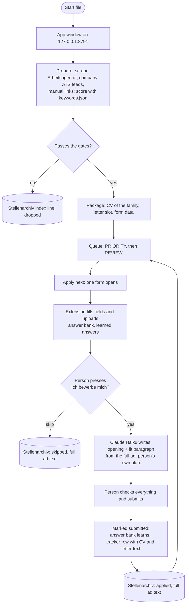
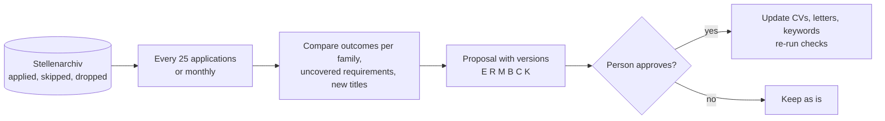

# Flowchart

How the package works, from the first chat message to a submitted application and later CV updates.
GitHub draws the diagrams below; in other viewers paste them into https://mermaid.live.

## 1. Setup in one Claude chat (stages 1 to 11)

```mermaid
flowchart TD
    A([Person connects this folder in the Claude desktop app<br/>and types: Read START_HERE.md]) --> B[Step 0: capability check<br/>folder, shell, Python tools, web search, OS]
    B --> C{workspace/STATE.md exists?}
    C -- yes --> D[Resume at Next action]
    C -- no --> E[Stage 1 Intake<br/>region, formats, level, languages, exclusions]
    D --> E
    E --> F[Person drops documents into workspace/sources]
    F --> G[Stage 2 Evidence ledger<br/>every fact: T1 applied, T2 basic, U unclear]
    G --> G2{Contradictions or gaps?}
    G2 -- yes --> G3[Ask the person] --> G
    G2 -- no --> H[Stage 3 Market search by Claude itself<br/>200-300 real ads + 40 holdout + 25 negatives]
    H --> I[Stage 4 Families<br/>proposals, topic check, overlap, tests]
    I --> I2{Smallest N that passes<br/>coverage, evidence, market, merge, split?}
    I2 -- no --> I
    I2 -- yes --> I3[Holdout: two raters, kappa >= 0.7]
    I3 --> I4[Person approves families B01..BNN]
    I4 --> J[Stage 5 Master CV<br/>Teil A-E]
    J --> K[Stage 6 One ATS CV per family<br/>build_cv_docx + ats_check]
    K --> L[Stage 7 Letter building blocks<br/>bank, app template, one template per CV]
    L --> M[Stage 8 Validation on holdout ads]
    M --> M2{Families stable?}
    M2 -- no --> I
    M2 -- yes --> N[Stage 9 keywords.json<br/>tested with score-folder]
    N --> O[Stage 10 Install<br/>Python, start file, Claude Code sign-in, extension]
    O --> P[Stage 11 Configure<br/>profile, answer bank, companies, searches, attachments]
    P --> Q([Check setup: all OK])
```

## 2. Daily use of the app (stage 12)

## 3. Maintenance (stage 13)

Never automated: submitting, consent boxes, CAPTCHAs, passwords, salary, visa and sponsorship answers.
